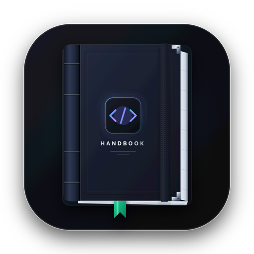

<p align="center">
  
</p>

<h1 align="center">Handbook</h1>

<p align="center">
  <strong>Pure speed. Ultra-lightweight. Zero friction.</strong><br>
  A high-performance, distraction-free code and text editor built for <strong>macOS</strong>, <strong>Linux</strong>, and <strong>Windows</strong>.<br>
  Universal platform independence from top to bottom.
</p>

<p align="center">
  <a href="https://github.com/imunishsoni/handbook/releases/latest"></a>
  <a href="https://github.com/imunishsoni/handbook/blob/main/LICENSE"></a>
  
  
  
</p>

---

## ⚡ Why Handbook?

Most modern editors carry heavy bundled browser runtimes, spawn 4+ auxiliary background processes, and consume hundreds of megabytes of memory before you write a single line of code.

**Handbook** is built differently:

- **🌍 True Platform Independence**: Runs identically and natively across **macOS** (Apple Silicon & Intel), **Linux** (Ubuntu, Debian, Fedora, Arch), and **Windows** (10 & 11).
- **⚡ Dual Runtime Architecture**:
  - **macOS Bare-Metal Core**: Compiled directly with `swiftc -O` as an Apple **Universal 2** binary (~4.4 MB installer, ~25ms startup, ~25 MB RAM).
  - **Universal Cross-Platform Core**: High-performance runtime with hardware acceleration, native window snapping, and seamless titlebar integration across Linux and Windows.
- **🎨 Dynamic Themes with Neutral Default**: 5 handcrafted themes (Handbook Neutral, Midnight Slate, Obsidian Black, Warm Coffee, Paper Light) with live arrow-key previews and real-time terminal synchronization.
- **🖥 Cross-Platform Integrated Terminal**: Low-latency terminal emulator powered by xterm.js automatically launching your default shell (`zsh`/`bash` on macOS and Linux, `PowerShell`/`cmd` on Windows) with full ANSI truecolor support.
- **⌨️ Sublime Text 4 Keymap Everywhere**: Complete 1:1 muscle memory compatibility on all platforms — `⌘` on Mac, `Ctrl` on Windows & Linux (`Ctrl+D`, `Ctrl+Shift+L`, `Ctrl+R`, `Ctrl+\``).
- **💻 Cross-Platform CLI**: Run `handbook .` from Terminal, Bash, Zsh, CMD, or PowerShell on any operating system.
- **🚫 Zero Nag Popups**: No license reminders, registration prompts, telemetry tracking, or modal interruptions.

---

## 💾 Installation & Downloads

Choose the package designed for your operating system from our [Latest Releases](https://github.com/imunishsoni/handbook/releases/latest):

### 🍏 macOS (macOS 10.15 Catalina through macOS 15+ Sequoia)
| Target | Installer Package | Format | Architecture |
| :--- | :--- | :--- | :--- |
| **All Macs (Universal)** | **[Handbook-mac-universal.dmg](https://github.com/imunishsoni/handbook/releases/latest/download/Handbook-mac-universal.dmg)** | Native DMG | Apple Silicon + Intel (4.4 MB) |
| **Apple Silicon Only** | **[Handbook-mac-arm64.dmg](https://github.com/imunishsoni/handbook/releases/latest/download/Handbook-mac-arm64.dmg)** | Native DMG | M1 / M2 / M3 / M4 (4.4 MB) |
| **Intel Mac Only** | **[Handbook-mac-x86_64.dmg](https://github.com/imunishsoni/handbook/releases/latest/download/Handbook-mac-x86_64.dmg)** | Native DMG | Core i3/i5/i7/i9/Xeon (4.4 MB) |

> *Portable `.zip` packages are also available: [Universal.zip](https://github.com/imunishsoni/handbook/releases/latest/download/Handbook-mac-universal.zip), [ARM64.zip](https://github.com/imunishsoni/handbook/releases/latest/download/Handbook-mac-arm64.zip), and [x86_64.zip](https://github.com/imunishsoni/handbook/releases/latest/download/Handbook-mac-x86_64.zip).*

### 🐧 Linux (Ubuntu, Debian, Fedora, Arch, openSUSE)
| Architecture | Package | Description |
| :--- | :--- | :--- |
| **x86_64 (Intel/AMD)** | **[Handbook-linux-x64.tar.gz](https://github.com/imunishsoni/handbook/releases/latest/download/Handbook-linux-x64.tar.gz)** | Standalone tarball with `.desktop` launcher |
| **x86_64 (Portable)** | **[Handbook-linux-x64.zip](https://github.com/imunishsoni/handbook/releases/latest/download/Handbook-linux-x64.zip)** | Portable ZIP package |
| **AArch64 (ARM64)** | **[Handbook-linux-arm64.tar.gz](https://github.com/imunishsoni/handbook/releases/latest/download/Handbook-linux-arm64.tar.gz)** | Standalone tarball for ARM64 Linux |

#### Linux Quick Install:
```bash
# Extract and launch
tar -xzf Handbook-linux-x64.tar.gz
cd Handbook-linux-x64
./Handbook

# Optional: Add desktop launcher to applications menu
cp handbook.desktop ~/.local/share/applications/
```

### 🪟 Windows (Windows 10 & Windows 11)
| Architecture | Package | Description |
| :--- | :--- | :--- |
| **Windows x64** | **[Handbook-windows-x64.zip](https://github.com/imunishsoni/handbook/releases/latest/download/Handbook-windows-x64.zip)** | Portable ZIP (Extract and run `Handbook.exe`) |

---

## 💻 Cross-Platform Command Line Launcher (`handbook`)

Launch Handbook from any shell on any operating system:

```bash
# Open Handbook
handbook

# Open the current working directory as a project workspace
handbook .

# Open a specific file
handbook src/main.rs
```

### Setup CLI Globally:

- **macOS**:
  ```bash
  sudo ln -sf "/Applications/Handbook.app/Contents/SharedSupport/bin/handbook" /usr/local/bin/handbook
  ```
- **Linux**:
  ```bash
  sudo ln -sf "$(pwd)/Handbook-linux-x64/handbook-cli" /usr/local/bin/handbook
  ```
- **Windows (Command Prompt / PowerShell)**:
  Add the Handbook folder containing `handbook.cmd` to your user `PATH` environment variable.

---

## 🎨 Customizable Themes

Handbook ships with 5 handcrafted color themes, with a balanced, neutral dark theme as the default:

- **Handbook Neutral** *(Default)*: Zinc & graphite charcoal (`#1c1c1f`) with gentle syntax colors for all-day focus.
- **Midnight Slate**: Deep dark slate (`#0d1117`) with vibrant indigo and cyan accents.
- **Obsidian Black**: True `#000000` dark theme optimized for OLED displays.
- **Warm Coffee**: Cozy sepia dark theme with warm espresso tones.
- **Paper Light**: Crisp, high-contrast light theme with clean neutral paper tones.

### How to Switch Themes:
1. Open the Command Palette (`⌘ ⇧ P` on macOS, `Ctrl + Shift + P` on Windows/Linux).
2. Type **Preferences: Color Theme** (or click the `🎨` icon in the bottom status bar).
3. Use the `↑` and `↓` arrow keys to preview themes instantly in real time.
4. Press `Enter` to apply. Your choice is automatically persisted across sessions.

---

## ⌨️ Sublime Text 4 Keymap (Cross-Platform)

Handbook adapts its keybindings automatically based on your operating system:

### ⚡ Text & Line Editing
| Action | macOS | Windows / Linux | Description |
| :--- | :--- | :--- | :--- |
| **Duplicate Line / Selection** | `⌘ ⇧ D` | `Ctrl + Shift + D` | Duplicates current line or text selection |
| **Delete Line** | `⌘ ⇧ K` / `⌃ ⇧ K` | `Ctrl + Shift + K` | Deletes line(s) under cursor |
| **Move Line Up** | `⌘ ⌃ ↑` / `⌥ ↑` | `Alt + ↑` | Swaps line(s) upward |
| **Move Line Down** | `⌘ ⌃ ↓` / `⌥ ↓` | `Alt + ↓` | Swaps line(s) downward |
| **Join Lines** | `⌘ J` | `Ctrl + J` | Joins line below with current line |
| **Insert Line Below** | `⌘ ↵` | `Ctrl + Enter` | Inserts newline below without splitting line |
| **Insert Line Above** | `⌘ ⇧ ↵` | `Ctrl + Shift + Enter` | Inserts newline above without splitting line |
| **Indent / Outdent** | `⌘ ]` / `⌘ [` | `Ctrl + ]` / `Ctrl + [` | Indents or unindents line/selection |
| **Delete to End of Line** | `⌘ K, ⌘ K` | `Ctrl + K, Ctrl + K` | Deletes text to end of current line |
| **Delete to Start of Line** | `⌘ K, ⌘ ⌫` | `Ctrl + K, Ctrl + Backspace` | Deletes text to start of current line |

### 🎯 Multi-Cursor & Selection
| Action | macOS | Windows / Linux | Description |
| :--- | :--- | :--- | :--- |
| **Quick Add Next** | `⌘ D` | `Ctrl + D` | Select word / add next occurrence |
| **Quick Skip Next** | `⌘ K, ⌘ D` | `Ctrl + K, Ctrl + D` | Skips current match and jumps to next |
| **Quick Find All** | `⌃ ⌘ G` | `Alt + F3` | Selects all occurrences across file |
| **Split Selection into Lines** | `⌘ ⇧ L` | `Ctrl + Shift + L` | Places cursor at end of each selected line |
| **Expand Selection to Line** | `⌘ L` | `Ctrl + L` | Selects line; repeat to expand down |
| **Select to Bracket** | `⌃ ⇧ M` | `Ctrl + Shift + M` | Selects content within enclosing brackets |
| **Add Cursor Above** | `⌘ ⌥ ↑` | `Ctrl + Alt + ↑` | Places an additional cursor above |
| **Add Cursor Below** | `⌘ ⌥ ↓` | `Ctrl + Alt + ↓` | Places an additional cursor below |
| **Soft Undo / Redo** | `⌘ U` / `⌘ ⇧ U` | `Ctrl + U` / `Ctrl + Shift + U` | Undoes / redoes cursor movements |

### 🚀 Navigation, Terminal & Tabs
| Action | macOS | Windows / Linux | Description |
| :--- | :--- | :--- | :--- |
| **Goto File** | `⌘ P` | `Ctrl + P` | Fuzzy project file search |
| **Goto Symbol** | `⌘ R` | `Ctrl + R` | Fuzzy symbol search (`@` functions, classes) |
| **Goto Line** | `⌘ G` | `Ctrl + G` | Jump to line number (`:`) |
| **Command Palette** | `⌘ ⇧ P` | `Ctrl + Shift + P` | Access all commands and themes (`>`) |
| **Toggle Terminal** | `⌃ \`` | `Ctrl + \`` | Shows/hides bottom integrated terminal |
| **Toggle Sidebar** | `⌘ B` | `Ctrl + B` | Shows/hides project file tree |
| **Find / Replace** | `⌘ F` / `⌥ ⌘ F` | `Ctrl + F` / `Ctrl + H` | Opens search and replace |
| **Next / Prev Tab** | `⌥ ⌘ →` / `⌥ ⌘ ←` | `Ctrl + PageDown` / `PageUp` | Switches between tabs |
| **Reopen Closed Tab** | `⌘ ⇧ T` | `Ctrl + Shift + T` | Restores the most recently closed tab |

---

## 🛠 Building From Source

```bash
# 1. Clone repository
git clone https://github.com/imunishsoni/handbook.git
cd handbook

# 2. Install dependencies
npm install

# 3. Generate cross-platform icons (.icns, .ico, .png)
npm run icon

# 4. Build distribution packages
# On macOS:
npm run build:native && npm run dmg

# Cross-platform packaging:
npm run pack:mac      # Package macOS
npm run pack:linux    # Package Linux x64/arm64
npm run pack:win      # Package Windows x64
npm run dist:all      # Package all supported platforms
```

---

## 🤝 Contributing & Community

Contributions, feature ideas, and **public issues are warmly welcomed!** Feel free to open a [public GitHub Issue](https://github.com/imunishsoni/handbook/issues) to report bugs, suggest enhancements, or start a discussion. Please review our [Contributing Guidelines](CONTRIBUTING.md), [Code of Conduct](CODE_OF_CONDUCT.md), and [Security Policy](SECURITY.md) before submitting pull requests.

---

## 📄 License

Handbook is open-sourced under the [MIT License](LICENSE).  
Created and maintained with ❤️ by [Munish Soni](https://github.com/imunishsoni).
